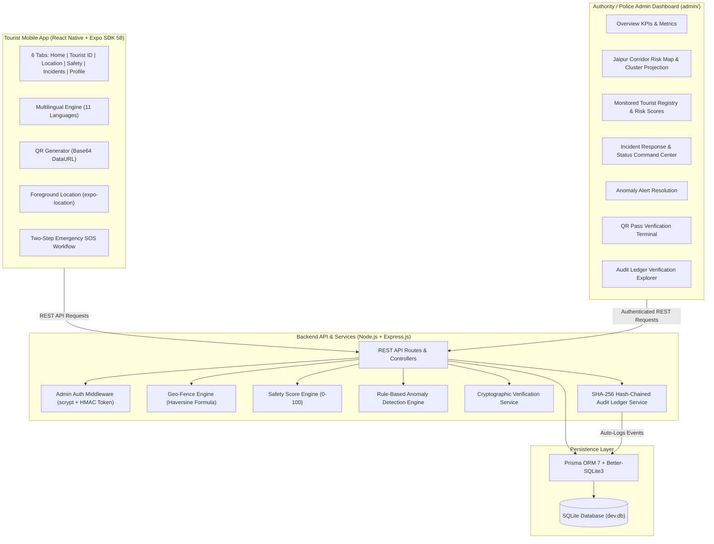
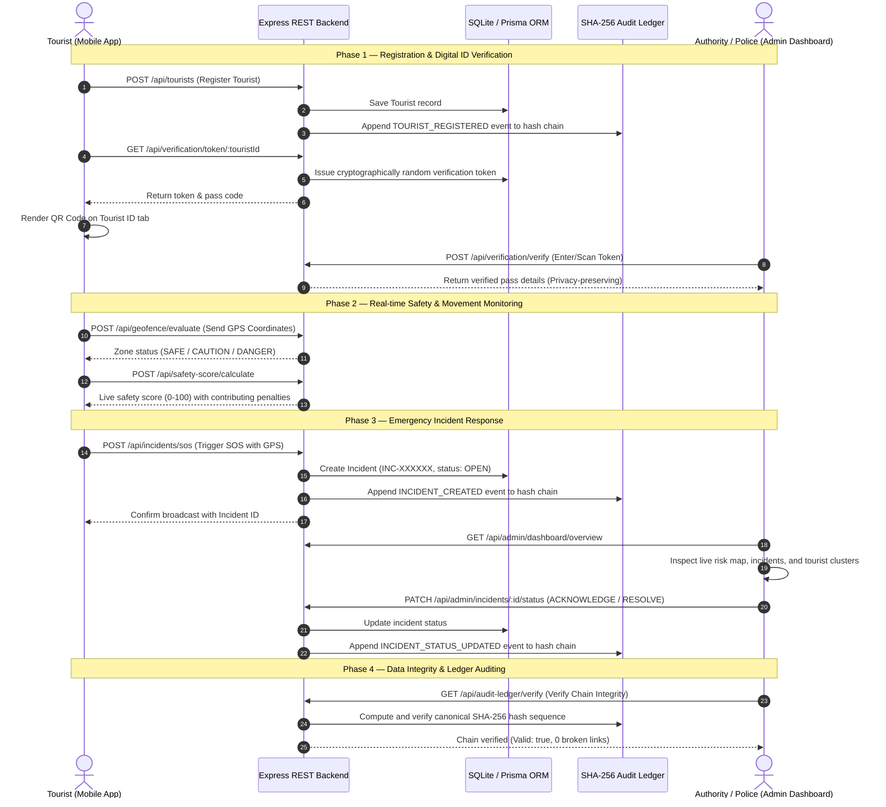

# Smart Tourist Safety Monitoring & Incident Response System

A full-stack tourist safety ecosystem featuring real-time mobile tracking, rule-based geo-fencing, deterministic safety scoring, two-step emergency SOS, explainable movement anomaly detection, an interactive Police/Authority Admin Dashboard, QR-based digital identity verification, a cryptographic SHA-256 tamper-evident hash-chained audit ledger, and multilingual localization across 11 Indian languages.

---

## 1. System Architecture



---

## 2. Complete End-to-End User & Authority Workflow



---

## 3. Key Completed Features

### 🏛️ Authority / Police Admin Dashboard (`admin/`)
- **Direct Access**: Statically served by the backend at `http://localhost:5050/admin`.
- **KPI Metrics**: Real-time summary cards displaying Total Registered Tourists, Active Tourists, Open Incidents, Unresolved Alerts, High-Risk Tourists, and Configured Safety Zones.
- **Geographic Risk Map & Tourist Clusters**:
  - Interactive SVG map projecting safety zones across the Jaipur tourism corridor (Amer Fort, Nahargarh, City Palace, Hawa Mahal, Jal Mahal, Aravalli Ridge).
  - Live tourist cluster pins dynamically calculated based on current active locations.
- **Monitored Tourists Directory**:
  - Comprehensive tourist registry with status, emergency contact, nationality, itinerary corridor, and real-time safety scores.
  - One-click manual safety score recalculation for any tourist.
- **Incident Management Command Center**:
  - Live table of all emergency SOS incidents with severity, coordinates, timestamps, and active status badges.
  - Interactive status controls: `ACKNOWLEDGE`, `RESOLVE`, or `CANCEL` with notes.
  - Every status modification automatically commits a tamper-evident record to the audit ledger.
- **Anomaly Alert Resolution**:
  - Filterable stream of rule-based movement anomaly alerts (Danger Zone entry, Route Deviation, Inactivity, Sudden Jump).
  - Status progression workflow (`ACKNOWLEDGE` / `RESOLVE`).
- **QR Pass Verifier Terminal**:
  - Police and checkpoint verification terminal.
  - Validates tokens generated by the mobile app against the cryptographic database.
  - Shows pass validity, verified stamp, corridor info, and safety score without disclosing private personal identity numbers or emergency contacts.
- **Audit Ledger Verification Explorer**:
  - Visual block explorer displaying event types, entity references, previous hashes, and SHA-256 block hashes.
  - Interactive **Verify Chain Integrity** button that calculates cryptographic proofs across the entire ledger.

### 🔐 QR-Based Digital Tourist ID
- **Secure Token Generation**: Generates 256-bit cryptographically secure random tokens (`st_tok_<hex>`) via `crypto.randomBytes(32)` stored as SHA-256 token hashes.
- **Privacy Preservation**: Raw phone numbers, emergency contact personal details, and sensitive document IDs are never embedded into QR codes.
- **Mobile QR Rendering**: Integrated `qrcode` generator converting tokens into native data URLs displayed in the **Tourist ID** tab.
- **Refresh & Revocation**: Expired or compromised tokens can be refreshed and revoked instantly on demand.

### ⛓️ Tamper-Evident SHA-256 Hash-Chained Audit Ledger
- **Cryptographic Hash Chaining**: Every critical action (`TOURIST_REGISTERED`, `INCIDENT_CREATED`, `INCIDENT_STATUS_UPDATED`, `ANOMALY_RECORDED`, `ANOMALY_STATUS_UPDATED`, `ZONE_CREATED`) is linked to the previous block via SHA-256 hashes (`previousHash -> blockHash`).
- **Deterministic Serialization**: Canonical key sorting prevents hash mismatches across platforms.
- **Genesis Block**: Fixed seed block anchoring the chain.
- **Tamper Detection**: An automated cryptographic verifier checks every block in sequence; modifying any field or hash immediately breaks the cryptographic proof and flags the exact corrupted block index.

### 🌐 Multilingual Support (11 Languages)
- Real-time language switching in the mobile **Profile** tab with an interactive language picker grid.
- Full localization dictionaries in authentic native scripts:
  1. **English** (`en`)
  2. **हिन्दी** (`hi` — Hindi)
  3. **বাংলা** (`bn` — Bengali)
  4. **తెలుగు** (`te` — Telugu)
  5. **मराठी** (`mr` — Marathi)
  6. **தமிழ்** (`ta` — Tamil)
  7. **اردو** (`ur` — Urdu)
  8. **ગુજરાતી** (`gu` — Gujarati)
  9. **ಕನ್ನಡ** (`kn` — Kannada)
  10. **മലയാളം** (`ml` — Malayalam)
  11. **ਪੰਜਾਬੀ** (`pa` — Punjabi)

### 🛡️ Admin Security & Access Control
- **Database Model**: `AdminUser` model in Prisma with unique email, full name, role (`SUPER_ADMIN`, `POLICE_OPERATOR`, `DISPATCHER`), and active status.
- **Password Hashing**: Native `crypto.scryptSync` with unique cryptographic salts (no third-party native binary compile issues).
- **Session Authentication**: HMAC-SHA256 signed session bearer tokens.
- **Default Bootstrap Credentials**:
  - **Email**: `admin@safetravel.gov.in`
  - **Password**: `Admin@Safety2026!`

---

## 4. Database Schema (Prisma Models)

```prisma
model Tourist {
  id                   String              @id @default(cuid())
  fullName             String
  passportOrIdNumber   String              @unique
  nationality          String
  phoneNumber          String
  emergencyContactName String
  emergencyContactPhone String
  itineraryCorridor    String?
  startDate            DateTime            @default(now())
  endDate              DateTime?
  status               String              @default("ACTIVE")
  createdAt            DateTime            @default(now())
  updatedAt            DateTime            @updatedAt
  incidents            Incident[]
  anomalies            AnomalyAlert[]
  verificationTokens   VerificationToken[]
}

model SafetyZone {
  id          String   @id @default(cuid())
  name        String
  description String?
  latitude    Float
  longitude   Float
  radiusMeters Float
  riskLevel   String   // SAFE, CAUTION, DANGER
  isActive    Boolean  @default(true)
  createdAt   DateTime @default(now())
  updatedAt   DateTime @updatedAt
}

model Incident {
  id          String    @id @default(cuid())
  referenceId String    @unique // INC-XXXXXX
  touristId   String
  type        String    @default("SOS")
  severity    String    @default("CRITICAL")
  status      String    @default("OPEN") // OPEN, ACKNOWLEDGED, RESOLVED, CANCELLED
  latitude    Float
  longitude   Float
  description String?
  reportedAt  DateTime  @default(now())
  resolvedAt  DateTime?
  tourist     Tourist   @relation(fields: [touristId], references: [id], onDelete: Cascade)
}

model AnomalyAlert {
  id          String    @id @default(cuid())
  touristId   String
  anomalyType String    // DANGER_ZONE_ENTRY, SUDDEN_LOCATION_CHANGE, ROUTE_DEVIATION, INACTIVITY, REPEATED_SUSPICIOUS_EVENTS
  severity    String    // LOW, MEDIUM, HIGH, CRITICAL
  description String
  latitude    Float
  longitude   Float
  status      String    @default("ACTIVE") // ACTIVE, ACKNOWLEDGED, RESOLVED
  detectedAt  DateTime  @default(now())
  resolvedAt  DateTime?
  tourist     Tourist   @relation(fields: [touristId], references: [id], onDelete: Cascade)
}

model VerificationToken {
  id          String    @id @default(cuid())
  touristId   String
  tokenHash   String    @unique
  passCode    String
  expiresAt   DateTime
  revokedAt   DateTime?
  createdAt   DateTime  @default(now())
  tourist     Tourist   @relation(fields: [touristId], references: [id], onDelete: Cascade)
}

model AuditLedger {
  id           String   @id @default(cuid())
  blockIndex   Int      @unique
  timestamp    DateTime @default(now())
  eventType    String   // TOURIST_REGISTERED, INCIDENT_CREATED, INCIDENT_STATUS_UPDATED, etc.
  entityType   String   // Tourist, Incident, AnomalyAlert, SafetyZone
  entityId     String
  payload      String   // Deterministic JSON string
  previousHash String
  blockHash    String   @unique
}

model AdminUser {
  id        String   @id @default(cuid())
  email     String   @unique
  password  String   // scrypt hash
  fullName  String
  role      String   @default("POLICE_OPERATOR")
  isActive  Boolean  @default(true)
  createdAt DateTime @default(now())
  updatedAt DateTime @updatedAt
}
```

---

## 5. Complete API Reference

### Health & Tourists
- `GET /api/health` — API health check
- `POST /api/tourists` — Register new tourist (auto-logs to audit ledger)
- `GET /api/tourists` — List all registered tourists
- `GET /api/tourists/:id` — Get tourist by ID

### Geo-Fencing & Safety Zones
- `GET /api/geofence/zones` — List all configured safety zones
- `GET /api/geofence/zones/:id` — Get safety zone by ID
- `POST /api/geofence/zones` — Create a safety zone (auto-logs to audit ledger)
- `POST /api/geofence/evaluate` — Evaluate GPS coordinates against safety zones

### Safety Scoring Engine
- `GET /api/safety-score/:touristId` — Compute real-time safety score
- `POST /api/safety-score/calculate` — Calculate score via POST payload

### Emergency SOS & Incidents
- `POST /api/incidents/sos` — Trigger emergency SOS incident (auto-logs to audit ledger)
- `GET /api/incidents` — List all incidents (with filters)
- `GET /api/incidents/:id` — Get incident by ID
- `GET /api/incidents/tourist/:touristId` — Get incidents for specific tourist
- `PATCH /api/incidents/:id/status` — Update incident status (auto-logs to audit ledger)

### Anomaly Detection
- `POST /api/anomalies/detect` — Run rule-based anomaly detection against coordinates
- `POST /api/anomalies/simulate` — Trigger simulated movement anomaly scenario
- `GET /api/anomalies` — List all anomaly alerts
- `GET /api/anomalies/tourist/:touristId` — List alerts for specific tourist
- `PATCH /api/anomalies/:id/status` — Update alert status (auto-logs to audit ledger)

### QR Verification Service
- `GET /api/verification/token/:touristId` — Retrieve active token or generate new one
- `POST /api/verification/token/generate` — Generate / renew verification token
- `POST /api/verification/verify` — Verify token from QR code (public safety check)
- `POST /api/verification/revoke` — Revoke token

### SHA-256 Audit Ledger
- `GET /api/audit-ledger` — Retrieve recent audit ledger blocks
- `GET /api/audit-ledger/verify` — Cryptographically verify entire chain integrity
- `GET /api/audit-ledger/:blockIndex` — Retrieve single block by index

### Authority / Police Admin APIs
- `POST /api/admin/login` — Authenticate admin operator (returns HMAC session token)
- `GET /api/admin/me` — Current admin session info
- `GET /api/admin/dashboard/overview` — Aggregated overview KPIs
- `GET /api/admin/tourists/monitored` — Monitored tourists with live safety scores
- `PATCH /api/admin/incidents/:id/status` — Admin update incident status
- `PATCH /api/admin/anomalies/:id/status` — Admin update anomaly alert status
- `GET /api/admin/map/clusters` — Dynamic tourist clusters & danger zones for map

---

## 6. How to Run the Project

### Prerequisites
- Node.js (v18+)
- npm

### 1. Start the Backend API & Admin Dashboard
```bash
cd backend
npm install
npm test          # Run automated API & audit chain test suite
npm run dev       # Starts Express API on http://localhost:5050
```
- **Admin Dashboard**: Open [http://localhost:5050/admin](http://localhost:5050/admin) in your web browser.
- **Default Login**:
  - Email: `admin@safetravel.gov.in`
  - Password: `Admin@Safety2026!`

### 2. Start the Mobile Application
```bash
cd mobile
npm install
npx expo start    # Starts Expo Metro bundler
```
- Open on Android/iOS via the Expo Go app, or press `w` for web preview.
- To configure the backend URL when using Expo Go on a physical phone, open the **Profile** tab in the app and set your machine's LAN IP (e.g. `http://192.168.x.x:5050/api`).

---

## 7. Testing & Demonstration Guide

### How to Test Admin Dashboard
1. Open [http://localhost:5050/admin](http://localhost:5050/admin).
2. Sign in with `admin@safetravel.gov.in` / `Admin@Safety2026!`.
3. View the **Overview** tab for real-time counts of tourists, incidents, and danger zones.
4. Switch to **Risk Map & Clusters** to see visual zone radii and cluster locations.
5. In **Tourist Monitoring**, view safety scores, filter by status, or trigger score recalculations.
6. In **Incident Management**, update an incident from `OPEN` to `ACKNOWLEDGED` or `RESOLVED`.
7. Go to **Audit Ledger** and click **Verify Chain Integrity**; confirm that 100% of blocks match their cryptographic hashes.

### How to Test QR Verification
1. In the mobile app, navigate to the **Tourist ID** tab.
2. The app fetches an active token and renders a scannable QR code along with the token string and Pass Code.
3. In the Admin Dashboard, go to **Verify QR Pass**.
4. Paste the token string and click **Verify Tourist Token**.
5. The system confirms the digital pass is valid, displays the tourist's name, nationality, corridor, and safety score, while withholding raw private identity documents.

### How to Test Multilingual Support
1. In the mobile app, go to the **Profile** tab.
2. Scroll to **Language / भाषा**.
3. Select any language (e.g., हिन्दी, বাংলা, தமிழ், ਪੰਜਾਬੀ).
4. Notice all titles, navigation headers, safety alerts, and action buttons immediately translate into the selected script.

---

## 8. Academic Project Disclaimers

1. **Rule-Based Anomaly Detection vs. Machine Learning**:
   The anomaly detection engine uses deterministic, explainable rule thresholds (time, displacement speed, zone boundaries). It is an explainable heuristic system, not a trained neural network or deep learning model.
2. **Cryptographic SHA-256 Audit Ledger vs. Public Blockchain**:
   The audit trail uses cryptographic SHA-256 hash chaining (similar to git commits or blockchain block headers) stored in SQLite for tamper evidence. It is not deployed on Ethereum, Polygon, or any decentralized blockchain network, and does not use smart contracts or consensus protocols.
3. **Simulated Emergency Incident Response**:
   The SOS system records and dispatches incident reports to the backend SQLite database for academic demonstration. It is not connected to actual police (112 / 911), medical, or municipal emergency dispatch services.
4. **Demonstration Safety Zones**:
   Zone coordinates (Amer Fort, Aravalli Ridge, Riverbank) are demonstration presets configured for the Jaipur tourist corridor and do not represent official government safety classifications.
5. **Demonstration Identity Data**:
   All names, passport numbers, and contact details used in test suites and demo seeds are synthetic and do not represent real individuals.
